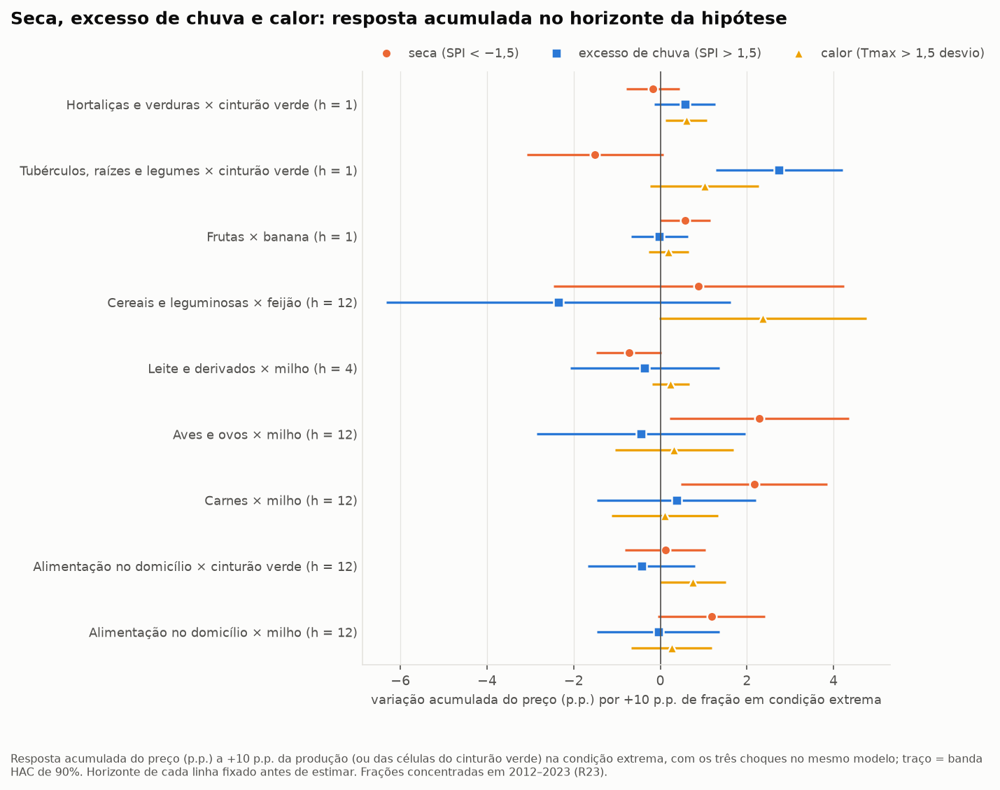
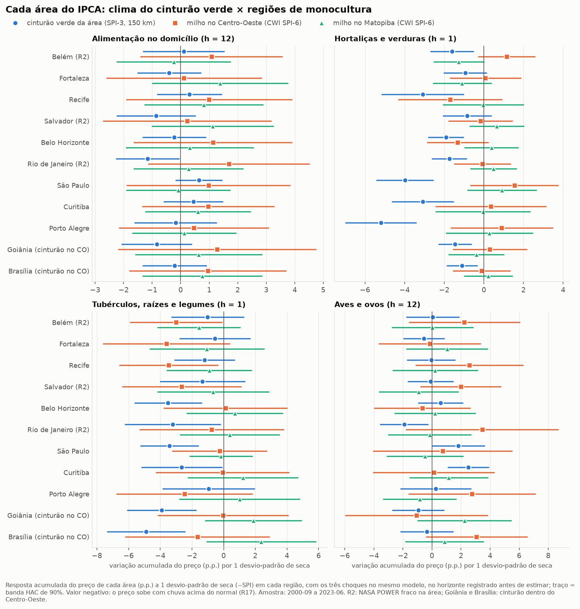
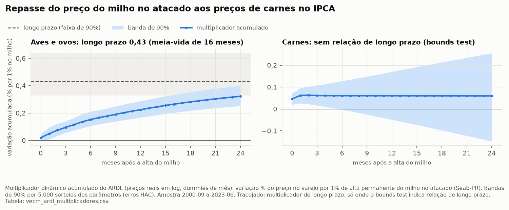
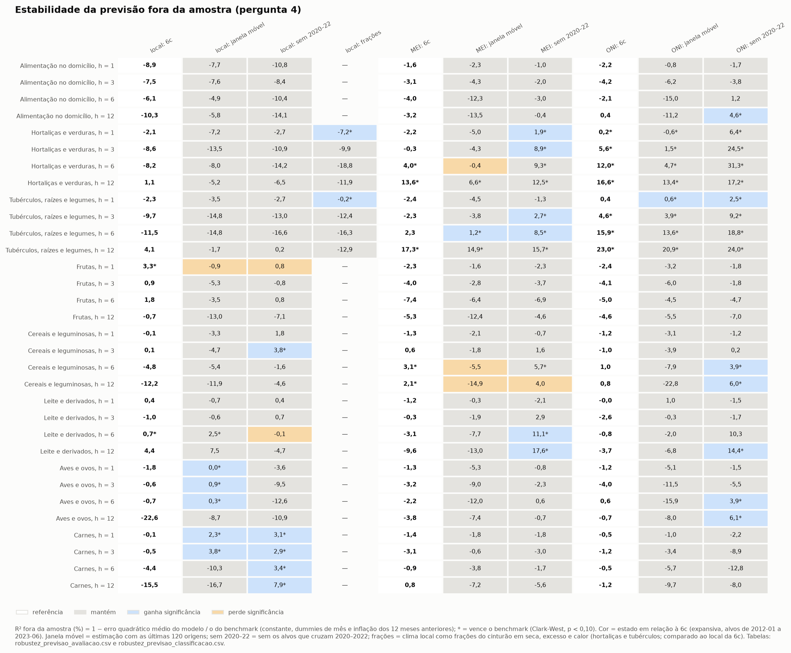
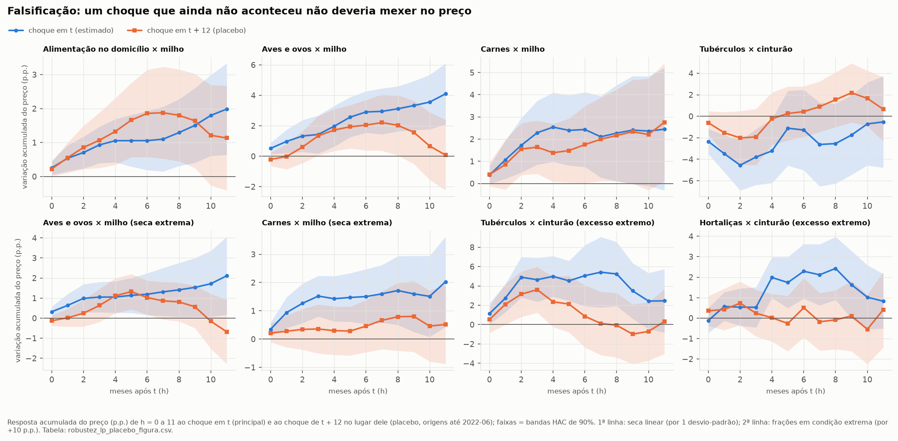

# Choques climáticos e inflação de alimentos no Brasil

Quanto a seca, a chuva demais, o calor e o El Niño mexem no preço da comida no Brasil, em quanto tempo, por qual caminho e o que os dados não permitem afirmar.

> **Abstract (English).** This project estimates how weather shocks (drought, excess rain, heat) and ENSO affect Brazilian food-at-home inflation (IPCA), by transmission channel, time horizon and geography of production, using public data from August 1999 to June 2023 (287 months). Local projections, panel regressions across 11 IPCA areas (state capitals and metropolitan regions), VECM/ARDL models and out-of-sample forecasts were specified in a configuration file before estimation and then stress-tested with alternative windows, thresholds, radii and a placebo test with a future shock. Vegetable and tuber prices rise after *excess rain* around each city, not after drought, and the effect fades within 3 to 4 months. A severe drought in corn-producing areas is followed by higher meat prices for more than a year. The ONI index improves 3- to 12-month forecasts of vegetable and tuber prices, while local weather does not. A simpler feed-cost channel (average corn drought → food inflation) failed the placebo test and is not attributed to weather. The project extends an MBA capstone in Data Science and Analytics (USP/Esalq, 2026).

## Resumo do projeto

O projeto mede o efeito de choques meteorológicos sobre a inflação de **alimentação no domicílio** do IPCA, separando-o por **canal de transmissão**, **horizonte** e **geografia da produção**. Usa só dados públicos, de agosto de 1999 a junho de 2023 (287 meses), para o Brasil e para as capitais e regiões metropolitanas do IPCA.

É uma expansão do trabalho de conclusão de curso *Análise do impacto da mudança climática na inflação de preços dos alimentos no Brasil* (MBA em Data Science e Analytics, USP/Esalq, 2026).

O trabalho partiu de quatro perguntas, cada uma com uma hipótese a testar:

1. **Velocidade e assimetria:** seca e calor extremo passam mais para os preços do que chuva demais? Quanto tempo o choque dura nos perecíveis?
2. **Perto ou longe:** o preço em cada capital responde mais ao clima do seu cinturão verde ou ao das regiões de grãos (Centro-Oeste e Matopiba)?
3. **Do milho à carne:** qual a defasagem entre a seca no milho e a alta de aves, carnes e leite?
4. **Global ou local:** os índices do El Niño (ONI e MEI) preveem melhor do que o clima local?

### Respostas em uma tabela

| Pergunta | O que os dados mostram | Grau de certeza |
|---|---|---|
| 1. Velocidade e assimetria | A hipótese se inverteu no hortifrúti: o que encarece hortaliças e tubérculos é **chuva demais**, não seca. O efeito some em 3 a 4 meses. Nas carnes, pesa a seca severa no milho, por mais de um ano. | firme no hortifrúti; provável nas carnes |
| 2. Perto ou longe | Hortaliças respondem ao próprio cinturão verde em 9 de 11 capitais; ao Centro-Oeste, em nenhuma. Para a alimentação como um todo, não foi possível concluir. | firme no hortifrúti; inconclusivo no resto |
| 3. Do milho à carne | Carnes ficam 2,16% mais caras em 12 meses quando a parte da safra de milho em seca severa sobe 10 p.p. Do preço do milho ao de aves e ovos, metade do repasse leva 12 meses. | provável nas carnes; incerto em aves; inconclusivo no leite |
| 4. Global ou local | O ONI melhora a previsão de hortaliças e tubérculos de 3 a 12 meses à frente (até 23,0% menos erro). O clima local não melhora nenhuma previsão de forma robusta. | firme no hortifrúti; nada na proteína |

**O que não se sustentou:** a versão mais simples do canal da ração (seca média no milho → alta geral da comida) era significativa na amostra, mas falhou no teste de falsificação: uma seca 12 meses no futuro "explicava" a alta do mesmo jeito. Ela não é atribuída ao clima ([detalhes abaixo](#o-que-não-se-sustentou)).

## Resultados por pergunta

Os códigos entre parênteses (R1 a R42) remetem ao registro de ressalvas em [`docs/RESSALVAS.md`](docs/RESSALVAS.md). Intervalos são de 90%. "p.p." é a variação acumulada do preço em pontos percentuais (100 × diferença dos logaritmos); para valores pequenos, equivale a % de alta.

### 1. Seca, calor ou chuva demais? E por quanto tempo?



*Série nacional (Parte 6a): resposta a +10 p.p. da produção, ou da área do cinturão verde, em seca, excesso de chuva ou calor, com os três choques no mesmo modelo. Cada linha está no horizonte fixado antes de estimar.*

- **Hortifrúti, por capital** (painel de 11 áreas com efeito fixo de mês, Partes 6b e 8b):
  - quando a parte do cinturão verde com chuva muito acima do normal sobe 10 p.p., as hortaliças ficam 0,62% mais caras no mês seguinte (0,40 a 0,83), e o efeito não se distingue de zero a partir do 3º mês;
  - nos tubérculos, o pico é de 0,35% em 2 meses e some no 4º;
  - a seca no cinturão não encarece as hortaliças (−0,27% no mês seguinte).
- **Hortifrúti, série nacional:** tubérculos sobem 2,74% no mês seguinte por +10 p.p. do cinturão em chuva extrema, e a diferença entre seca e excesso é de −4,25 p.p. Aqui o placebo fica no limite (3 de 12 horizontes); nas hortaliças, o agregado nacional é inconclusivo (R39).
- **Calor:** nas hortaliças das capitais, o efeito não se distingue de zero (0,05%). Na série nacional (0,60%), é frágil.
- **Proteína:** com +10 p.p. da safra de milho em seca severa, as carnes ficam 2,16% mais caras em 12 meses (0,47 a 3,86), e o efeito continua acima de zero até o 17º mês.
- **Certeza:**
  - no hortifrúti, firme: o efeito se repete com cinturão de 300 km e com as 16 áreas, e a chuva do futuro não tem efeito em nenhum dos 12 horizontes do placebo;
  - nas carnes, provável: as secas severas no milho se concentram depois de 2012 (R17, R23, R25, R27, R39).

### 2. O clima de perto ou o de longe?



*Parte 6b: resposta de cada área a 1 desvio-padrão de seca (−SPI) em cada região, com os três choques no mesmo modelo. Valor negativo: o preço sobe com chuva acima do normal.*

- **Hortaliças:** em 9 de 11 capitais, um mês de chuva acima do normal no próprio cinturão vem com hortaliças mais caras no mês seguinte.
  - O efeito vai de 1,10% (Brasília) a 5,20% (Porto Alegre) por desvio-padrão, ou de 0,74% a 2,97% por inovação típica.
  - O clima do Centro-Oeste e o do Matopiba não têm efeito detectável em nenhuma capital.
- **Painel:**
  - o efeito conjunto é de 2,00% e fica em 1,98% com efeito fixo de mês, que absorve dólar, El Niño e o clima das regiões de grãos;
  - a diferença entre o cinturão e o Centro-Oeste é de 2,08 p.p.;
  - com cinturão de 300 km, o efeito é de 1,95% e 9 capitais mantêm o resultado; com 16 áreas, 1,92%.
- **Alimentação no domicílio:** o coeficiente do Centro-Oeste é positivo em 11 de 11 capitais, mas não se distingue de zero em nenhuma. Como o clima das regiões de grãos é o mesmo para todas as capitais, a comparação entre capitais não o identifica (R28).
- **Certeza:** firme no hortifrúti; inconclusivo na alimentação e na proteína (R2, R4, R8, R28, R41).

### 3. Quanto tempo da seca no milho até a carne?



*Parte 7b: quanto de uma alta permanente de 1% no preço real do milho no atacado (Seab-PR) aparece no preço real ao consumidor, mês a mês (modelo ARDL).*

- **Pelo clima:**
  - carnes +2,16% em 12 meses por +10 p.p. da safra de milho em seca severa, ou 1,64% por inovação típica (7,6 p.p.);
  - nos testes de robustez, o efeito ficou entre 1,55% e 2,61%, e o placebo não teve efeito em nenhum horizonte (0 de 12);
  - em aves e ovos, +2,29% em 12 meses, mas o placebo teve efeito em 3 de 12 horizontes, no limite do aceitável.
- **Pelo preço do grão:**
  - +10% no milho vêm com aves e ovos +1,5% em 6 meses, +2,2% em 12 meses e +4,3% no longo prazo;
  - a elasticidade de longo prazo é de 0,43 (ARDL) a 0,47 (VECM), e vai de 0,29 a 0,60 nas variações testadas;
  - metade do repasse leva 12 meses.
- **Carnes de boi e de porco:** sem relação de longo prazo com o milho (teste de limites: F = 0,67). O repasse é curto: 0,046% por 1% no mês da alta, que deixa de se distinguir de zero no 6º mês.
- **Não há um "mês certo":** a alta das carnes começa logo depois da seca e se acumula por cerca de um ano. O "lag ótimo" é uma estimativa imprecisa (R26).
- **Certeza:**
  - provável nas carnes;
  - incerto em aves, porque o milho também reage ao preço do frango (R35);
  - inconclusivo no leite, porque a pastagem não foi medida (R19).
  - Outras ressalvas: R23, R24, R32, R37, R38.

### 4. O El Niño prevê melhor que o clima local?



*Partes 6c e 8c: redução do erro quadrático médio (R² fora da amostra, %) ao acrescentar cada preditor a uma referência com sazonalidade e 12 defasagens da inflação. \* = vence a referência no teste de Clark-West (p < 0,10).*

- **Desenho:** 25.632 previsões pseudo fora da amostra, com janela crescente e origens a partir de 2011-12. São 8 grupos × 4 horizontes (1, 3, 6 e 12 meses), ou 32 casos por preditor. Por acaso, um preditor sem valor "venceria" em cerca de 3,2 casos.
- **ONI (t − 1):**
  - vence em 7 de 32 casos, todos no hortifrúti, e as 7 vitórias resistem à janela móvel de 120 meses e à avaliação sem 2020–2022;
  - em 12 meses, o erro cai 23,0% nos tubérculos e 16,6% nas hortaliças.
- **MEI:** 5 vitórias, 2 robustas (12 meses, hortaliças e tubérculos).
- **Clima local:** 2 vitórias, nenhuma robusta.
- **Associação não é previsão:**
  - o clima local (a seca no milho; na alimentação, junto com o cinturão), associado à alta da comida na amostra toda, piora a previsão de 12 meses: R² de −10% na alimentação, −23% em aves e ovos e −16% nas carnes;
  - sem 2020–2022, as carnes passam a um ganho de 7,9%, mas a alimentação (−14%) e aves e ovos (−11%) continuam piores.
- **Certeza:** firme no hortifrúti. O ganho vem de poucos episódios (alvos de 2016–2018 e 2022), e a previsão usa dados já revisados (R12, R30, R31, R42).

### O que não se sustentou



*Parte 8a: azul, a resposta ao choque do mês; laranja, a resposta à seca de 12 meses depois, posta no lugar dela. Uma seca futura não pode mexer no preço de hoje; se ela "explica" o preço, a associação vem de outra coisa.*

- **Canal da ração linear:** a seca média no milho (CWI) se associava a aves e ovos 4,14% mais caros e à alimentação no domicílio 2,16% mais cara em 12 meses, por desvio-padrão.
- **O placebo falhou:**
  - a seca futura teve efeito em 6 (aves) e 10 (alimentação) dos 12 horizontes;
  - na alimentação, chegou a 1,88% no 7º mês, mais do que a própria seca no mesmo horizonte (1,10%).
  - A associação provavelmente vem de ciclos lentos que seca e preços compartilham, não do clima (R16, R21, R38).
- **O que resistiu ao mesmo teste:**
  - a seca extrema no milho → carnes passa (0 de 12 horizontes, linha de baixo);
  - a seca extrema → aves e ovos e a chuva extrema → tubérculos na série nacional ficam no limite, com 3 de 12 (R39);
  - por capital, a chuva extrema no cinturão passa nas hortaliças e nos tubérculos (0 de 12).
- **Parte 8 no total:** 261 coeficientes reclassificados, 43 robustos em todos os testes. O placebo falhou em 15 dos 63 em que foi aplicado.

## Dados

Todos públicos e abertos. A janela termina em junho de 2023 porque, comparado às estações do INMET, o NASA POWER muda de patamar a partir do segundo semestre de 2023 (temperatura) e de 2024 (chuva). Seguir adiante misturaria mudança do instrumento com mudança do clima (R1).

| Fonte | O que entra | Período | Cobertura |
|---|---|---|---|
| IBGE/SIDRA · IPCA | Alimentação no domicílio e 7 grupos (cereais, tubérculos, hortaliças, frutas, carnes, aves e ovos, leite) e o óleo diesel | 1991 a 2026; usado de 1999 a 2023 | Brasil e 16 áreas; 11 desde 1991, 5 a partir de 2014 ou 2018; 5 tabelas do SIDRA costuradas por um mapa de códigos |
| IBGE/SIDRA · PAM | Produção por microrregião, para os pesos espaciais | 1990 a 2025, anual | 12 culturas, 558 microrregiões |
| IBGE/SIDRA · LSPA | Previsão de safra dentro do ano | 2006 a 2026, mensal | baixada e conferida; não entrou nos modelos |
| NASA POWER | Chuva, temperatura, vento, umidade e radiação diários (reanálise) | 1981 a 2026; usado até 2023-06 | 496 células de cerca de 55 × 69 km, sem falhas |
| INMET | Estações perto das capitais, para validar o NASA POWER | 2001 a 2025 | 16 estações, de 2% a 46% de meses faltantes |
| NOAA PSL | ONI e MEI v2 | 1950 (ONI) e 1979 (MEI) a 2026 | completos |
| BCB/SGS | PTAX e IC-Br Agropecuária | 1994 e 1998 a 2026 | completos |
| Seab-PR (IPEADATA) e Conab | Milho no atacado: Paraná como substituto regional e São Paulo como robustez | 1990 a 2026 | não há série nacional aberta; representatividade do Paraná testada antes do uso (R32) |

O SPI-3 e o SPI-6 (gama, referência 1991–2020) reconhecem 4 secas documentadas: Sudeste 2014/15, Bacia do Paraná 2020/21, Semiárido 2012–2016 e Amazônia 2023.

## Método

- **Clima onde se produz:**
  - o SPI de cada microrregião é ponderado pela produção de cada cultura (CWI), com pesos defasados de 1 a 3 anos para que o próprio choque não altere o peso;
  - o cinturão verde é o clima a até 150 km de cada capital (300 km na robustez);
  - os choques extremos são frações da produção, ou da área do cinturão, com SPI < −1,5 (seca) ou > +1,5 (excesso).
- **Local Projections (Jordà, 2005):** para h = 0 a 18 meses, a variável dependente é 100 × [ln p(t+h) − ln p(t−1)].
  - Controles: 12 defasagens do choque e da inflação, dummies de mês e tendência.
  - Erros de Newey-West com h + 1 defasagens.
  - Por capital: painel com efeito fixo de mês e erros de Driscoll-Kraay.
- **VECM e ARDL:**
  - preços reais em log;
  - teste de Johansen, com posto e caso escolhidos pelo princípio de Pantula, e teste de limites;
  - multiplicadores acumulados com intervalos por simulação.
- **Previsão fora da amostra:**
  - regressão direta com janela crescente;
  - Clark-West para "vencer" a referência;
  - Diebold-Mariano para comparar El Niño e clima local.
- **Robustez (Parte 8):**
  - com e sem controles (câmbio, diesel, IC-Br);
  - janelas a partir de 2006 e 2012, e sem 2020–2022;
  - SPI-3 × SPI-6, pesos fixos, limiares ±1,0 e ±2,0;
  - cinturão de 300 km, 16 áreas;
  - placebo com o choque de t + 12.
- **Disciplina:**
  - cada especificação foi registrada em [`config/settings.yaml`](config/settings.yaml) antes de estimar;
  - os resultados de todas as especificações testadas, inclusive as que não deram resultado, estão em `outputs/tabelas/`;
  - os tamanhos são reportados em duas escalas: por desvio-padrão do nível e por inovação típica (R22, R29).

## Limitações

O registro completo está em [`docs/RESSALVAS.md`](docs/RESSALVAS.md). As principais:

- **Associação não é causa.** Secas coincidiram com ciclos de commodities e com o dólar alto, e o repasse entre milho e frango corre nos dois sentidos (R16, R21, R35, R38).
- **Reanálise, não estações.** O NASA POWER acompanha mal a chuva em parte do Norte e do Nordeste, e cada microrregião é representada por um ponto (R2, R5, R11, R13, R30).
- **Poucos episódios extremos.** As secas severas no milho se concentram depois de 2012, e 2020–2022 pesa contra todos os preditores (R23, R31, R42).
- **Produtos agregados e canais não medidos.** "Carnes" junta boi e porco, e o leite depende da pastagem, que não foi medida (R19, R24, R36).
- **Preço do grão regional.** O milho no atacado é do Paraná, e o tamanho do repasse varia com o modelo (R32–R34, R37).
- **Muitos testes.** Os gráficos mostram as bandas completas, e as contagens de resultados significativos são comparadas ao esperado por acaso (R26).

## Próximos passos

- Usar uma fonte de clima homogênea depois de 2023 e testar a seca e a inflação de alimentos de 2024.
- Refazer a previsão com os dados como eram conhecidos em cada mês (*real time*).
- Separar boi, porco, frango e ovos pelos subitens do IPCA, e medir a pastagem para o leite.
- Usar calendários de safra regionais, sobretudo para a soja no Sul.
- Modelar o ciclo comum de seca e preços que derrubou o canal da ração linear, incluindo o ciclo global de commodities.

## Como ler este repositório

**Os notebooks são arquivos `.py` no formato *percent* do [jupytext](https://jupytext.readthedocs.io).** `# %%` abre uma célula de código e `# %% [markdown]` abre uma célula de texto. O VS Code e o PyCharm os abrem como notebooks, e o JupyterLab também, com o jupytext instalado. Para gerar o `.ipynb`: `jupytext --to ipynb notebooks/05_modelagem_econometrica_local_projections.py`. Esse formato foi escolhido porque:

- o diff no git mostra só mudanças de código, sem saídas, imagens em base64 e contadores de execução;
- cada notebook roda de cima a baixo, sem estado escondido de células executadas fora de ordem, e o mesmo arquivo roda como script no pipeline;
- o `ruff` checa e formata os notebooks como qualquer código.

Os resultados ficam em `outputs/`: cada figura de `outputs/figuras/` tem a tabela que a gerou em `outputs/tabelas/`.

| Notebook | Parte | O que faz |
|---|---|---|
| `01_ingestao_dados.py` | 1 | IPCA, produção, macro, ENSO e clima, com cache e lakehouse; cobertura e janela amostral |
| `02_engenharia_features_climaticas.py` | 2 | SPI, GDD, balanço hídrico, geada, calor extremo; validação do SPI e da fonte de clima |
| `03_ponderacao_espacial_safras.py` | 3 | pesos de produção, CWI, cinturões verdes |
| `04_eda_e_decomposicao_temporal.py` | 4 | STL, ADF/KPSS, correlação cruzada, coerência wavelet |
| `05_modelagem_econometrica_local_projections.py` | 5 e 6 | Local Projections agregadas, por grupo, não lineares, por área, ENSO e previsão |
| `06_modelagem_dinamica_varx_ardl.py` | 7 | representatividade do preço do Paraná; VECM e ARDL |
| `07_testes_robustez.py` | 8 | robustez das LPs, dos painéis e da previsão; consolidação |

As decisões de método, com a justificativa de cada uma, ficam comentadas em [`config/settings.yaml`](config/settings.yaml). As 42 ressalvas, onde cada uma pesa e o que foi feito com ela, estão em [`docs/RESSALVAS.md`](docs/RESSALVAS.md).

## Como reproduzir

```bash
python3.12 -m venv .venv && source .venv/bin/activate   # Python 3.11+
pip install -r requirements.txt
for n in notebooks/0[1-7]_*.py; do python "$n"; done     # na ordem; 01 e 02 aceitam --refresh
pytest -q                                                # 160 testes
ruff check . && ruff format --check .
```

- **Primeira execução:** cerca de 2 horas, quase tudo em downloads, com retry e log de cada requisição. As respostas brutas ficam em `data/raw/`, e as execuções seguintes usam esse cache: cerca de 11 minutos e 0 requisições.
- **Arquivos congelados:** `data/` não é versionado, com duas exceções: `data/raw/noaa/` (ONI e MEI, baixados em 2026-10-05) e `data/raw/conab/` (2026-10-08). A NOAA revisa o ONI, o que muda os resultados da pergunta 4. O arquivo da Conab é uma janela móvel de 12 meses (R34), e em novembro de 2026 o portal respondia com o certificado de outro domínio. O `--refresh` do notebook 01 sobrescreve o ONI e o MEI.
- **Token do INMET:** o `.env` é opcional; sem token, o INMET vem dos arquivos anuais do portal.
- **Revisões das fontes:** com esses arquivos, uma carga completa feita em 2026-11-03 manteve os números de 110 das 118 saídas, incluindo todos os modelos. As outras 8 são descritivas e só mudam com o mês mais recente das fontes; até o fim da amostra (2023-06), nada se move. Sem congelar, com o ONI de novembro de 2026, ele continua vencendo em 7 de 32 casos, mas em 12 meses o erro cai 20,8% nos tubérculos (não 23,0%) e 15,9% nas hortaliças (não 16,6%).
- **Determinismo:** os notebooks de modelagem (05 e 07) foram rodados duas vezes com o mesmo cache, com saídas idênticas.

## Estrutura

```
config/settings.yaml   códigos de séries, períodos, coordenadas, raios, limiares e especificações
src/clima_inflacao/    lógica testável: ingestao/, features/, espacial/, modelos/
notebooks/             pipeline 01 a 07 (jupytext, formato percent)
tests/                 testes unitários (pytest)
outputs/               figuras/ e as tabelas/ que as geraram
docs/RESSALVAS.md      registro de ressalvas de dados e de método
data/                  dados brutos, processados e lakehouse DuckDB (só raw/noaa/ e raw/conab/ são versionados)
```

## Licença

O código está sob a [licença MIT](LICENSE). Os dados pertencem às fontes e seguem os termos delas.
